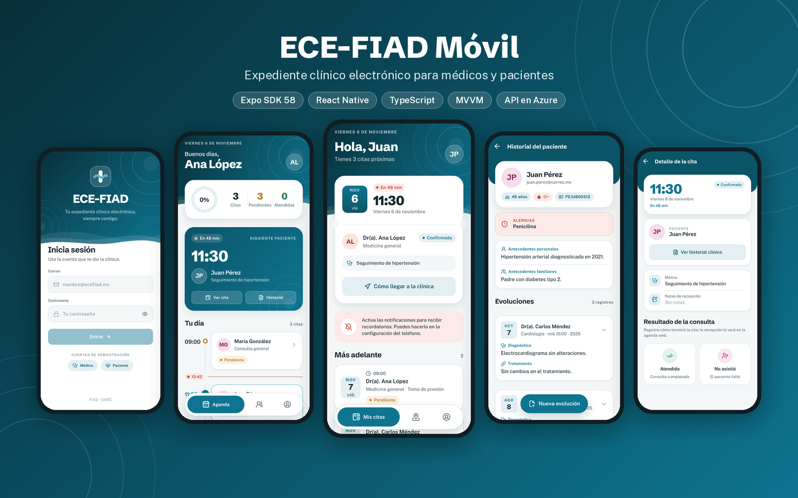
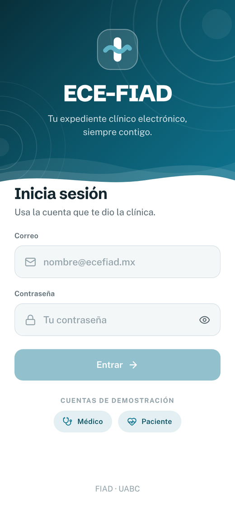
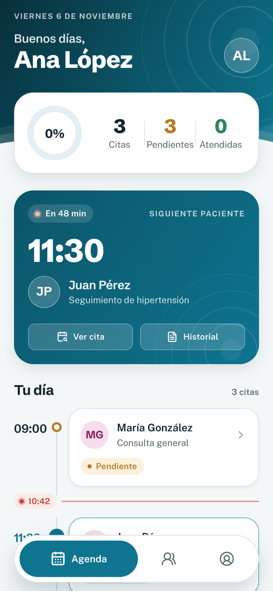
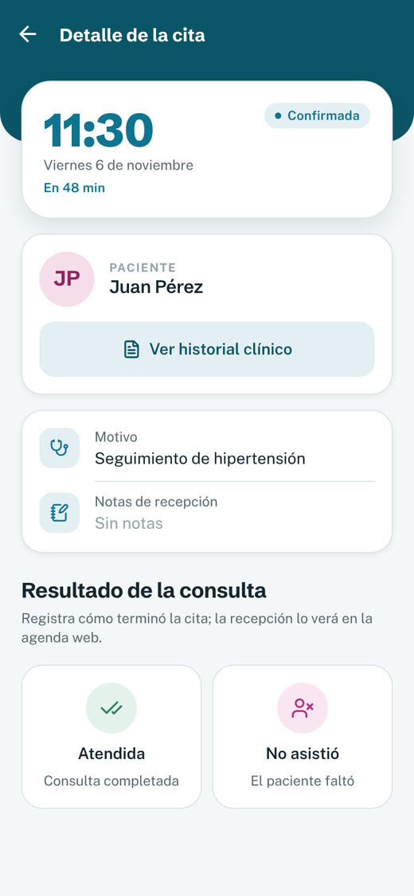
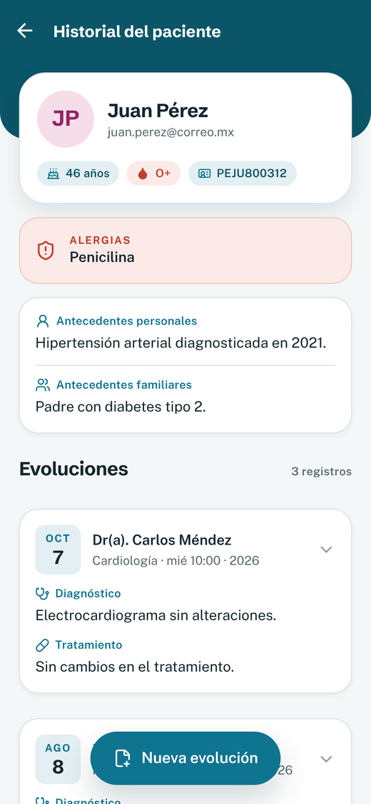
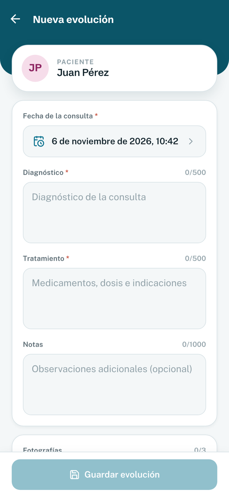
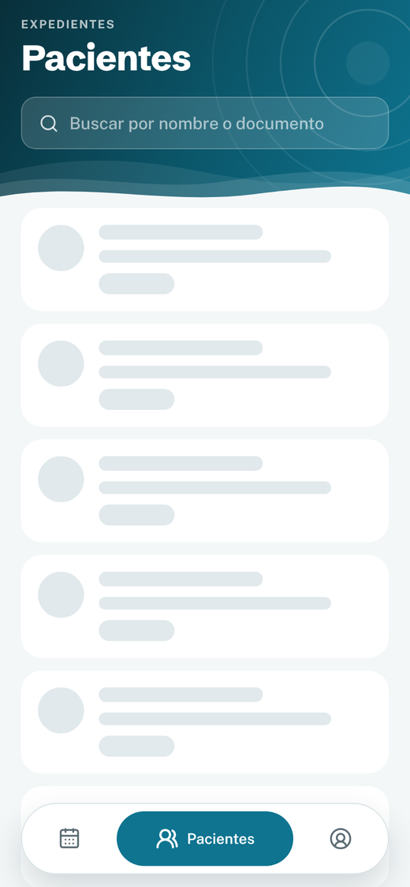
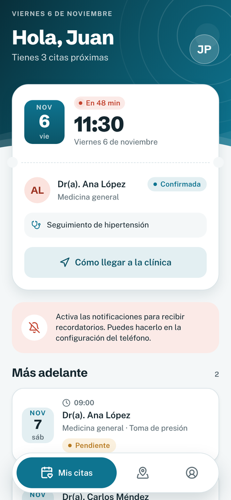
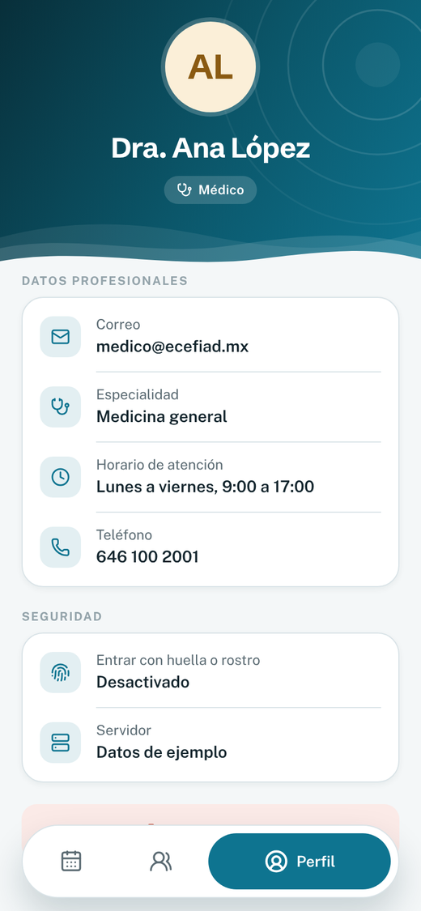
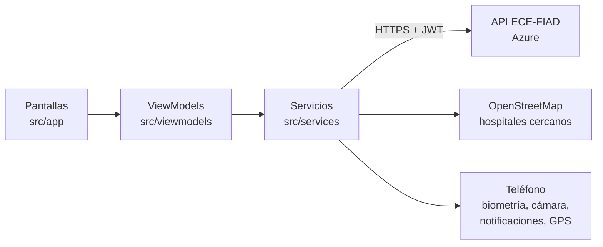

<p align="center">
  
</p>

<h1 align="center">ECE-FIAD Móvil</h1>

<p align="center">
  App del expediente clínico electrónico ECE-FIAD para médicos y pacientes.<br>
  Agenda del día, historial clínico, evoluciones con fotografías, recordatorios de citas y hospitales cercanos en el mapa.
</p>

<p align="center">
  <a href="https://github.com/BrayanArM98/ece-fiad-web"></a>
  <a href="https://ece-fiad-web.vercel.app"></a>
</p>

<p align="center">
  
  
  
  
  
  
  
</p>

---

## Contenido

- [Capturas](#capturas)
- [Funcionalidades](#funcionalidades)
- [Funciones del teléfono](#funciones-del-teléfono)
- [Arquitectura](#arquitectura)
- [Diseño](#diseño)
- [Tecnologías](#tecnologías)
- [Ejecutar el proyecto](#ejecutar-el-proyecto)
- [Especificaciones](#especificaciones)
- [Autor](#autor)

## Capturas

<table>
  <tr>
    <td align="center" width="25%"><br><b>Inicio de sesión</b><br><sub>Contraseña o huella</sub></td>
    <td align="center" width="25%"><br><b>Agenda del día</b><br><sub>Siguiente paciente en vivo</sub></td>
    <td align="center" width="25%"><br><b>Detalle de la cita</b><br><sub>Registro del resultado</sub></td>
    <td align="center" width="25%"><br><b>Historial clínico</b><br><sub>Alergias y evoluciones</sub></td>
  </tr>
  <tr>
    <td align="center"><br><b>Nueva evolución</b><br><sub>Con fotografías</sub></td>
    <td align="center"><br><b>Pacientes</b><br><sub>Búsqueda sin acentos</sub></td>
    <td align="center"><br><b>Mis citas</b><br><sub>Cuenta regresiva y recordatorios</sub></td>
    <td align="center"><br><b>Perfil</b><br><sub>Datos del expediente</sub></td>
  </tr>
</table>

## Funcionalidades

**Médico**
- **Agenda del día (F02):** avance del día, siguiente paciente con cuenta regresiva, línea de tiempo con la hora actual y canceladas al final.
- **Resultado de la cita:** confirma, marca como atendida o como no asistió; el cambio se ve en la agenda web.
- **Historial del paciente (F03):** datos, alergias resaltadas, antecedentes y evoluciones que se expanden con notas y fotos.
- **Registrar evolución (F04)** con diagnóstico, tratamiento, notas y **hasta 3 fotografías (F05)**.
- **Pacientes:** lista con búsqueda por nombre o documento.

**Paciente**
- **Mis citas (F06):** próxima cita con cuenta regresiva, doctor y especialidad, y **recordatorios** un día y una hora antes.
- **Clínica (F07):** la clínica ECE-FIAD y los **hospitales y clínicas reales cercanos** (OpenStreetMap) en el mapa, con distancia, "Cómo llegar" y "Llamar".

**Ambos**
- **Inicio de sesión (F01)** con las cuentas del sistema web y acceso con **huella o rostro**.

## Funciones del teléfono

- **Biometría:** `expo-local-authentication` para entrar con huella o rostro.
- **Almacenamiento seguro:** `expo-secure-store` para guardar la sesión y el token solo con biometría activa.
- **Cámara y galería:** `expo-image-picker` para las fotografías de las evoluciones, guardadas con `expo-file-system`.
- **Notificaciones locales:** `expo-notifications` para los recordatorios de citas, sin servidor.
- **Ubicación y mapas:** `expo-location` y `react-native-maps` para la distancia y el mapa.
- **Enlaces:** `Linking` para abrir la ruta en Google Maps o Apple Maps y el marcador telefónico.
- **Vibración:** `expo-haptics` como respuesta táctil.

## Arquitectura

La app sigue **MVVM**: las pantallas solo dibujan el estado que les da su ViewModel, y los ViewModels usan servicios que hablan con la API o con el teléfono.



```text
src/
├── app/          # Pantallas y rutas (Expo Router), separadas por rol
├── viewmodels/   # Un hook por pantalla con su estado y acciones
├── services/     # API, sesión, biometría, cámara, notificaciones, ubicación
├── models/       # Tipos con la misma forma que la API
├── components/   # Componentes de pantalla y kit de diseño (ui/)
├── theme/        # Colores, tipografía y sombras "Marea"
├── utils/        # Reglas de negocio puras (agenda, fechas, distancias)
└── config/       # API, clínica y modo de prueba
```

Las rutas protegidas solo existen con la sesión del rol correcto: al cerrar sesión desaparecen del historial y el botón "atrás" no regresa a datos clínicos.

## Diseño

Sistema de diseño propio **"Marea"**, el mismo de ECE-FIAD Web: degradado azul marino, olas y anillos en los encabezados, tipografías Schibsted Grotesk y Public Sans, barra de pestañas flotante, tarjetas con respuesta táctil y animaciones de entrada. Los detalles están en [`specs/04-diseno.md`](specs/04-diseno.md).

## Tecnologías

- React Native 0.88 con Expo SDK 58, Expo Router y React Compiler
- TypeScript
- Reanimated, react-native-svg, expo-linear-gradient y lucide-react-native
- API REST de [ECE-FIAD Web](https://github.com/BrayanArM98/ece-fiad-web) (ASP.NET Core en Azure)

## Ejecutar el proyecto

Requisitos: Node.js y la app **Expo Go** (SDK 58) en el teléfono.

```bash
npm install
npx expo start -c
```

Escanea el código QR con Expo Go (Android) o con la cámara (iPhone).

- La app se conecta sola a la API de Azure (`.env.development`). La primera petición del día puede tardar alrededor de un minuto mientras el servidor despierta.
- Para usar una API local o el modo demostración sin servidor, ver [`specs/03-api.md`](specs/03-api.md).
- Cuentas de demostración: `medico@ecefiad.mx` y `paciente@ecefiad.mx`, con la contraseña configurada en la API.

## Especificaciones

El proyecto se desarrolla con **Spec-Driven Development**. El problema, el MVP, la navegación, el modelo de datos, la conexión con la API, el diseño y una especificación por feature (F01 a F07) están en [`specs/`](specs/README.md).

## Autor

**Brayan Arturo Rocha Meneses**
Ingeniería en Software y Tecnologías Emergentes · Facultad de Ingeniería, Arquitectura y Diseño, UABC.
Proyecto de la materia Aplicaciones Móviles.

## Licencia

[MIT](LICENSE)
